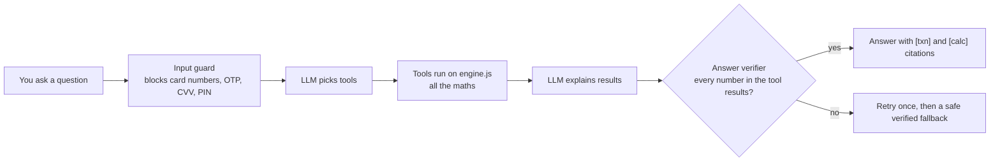
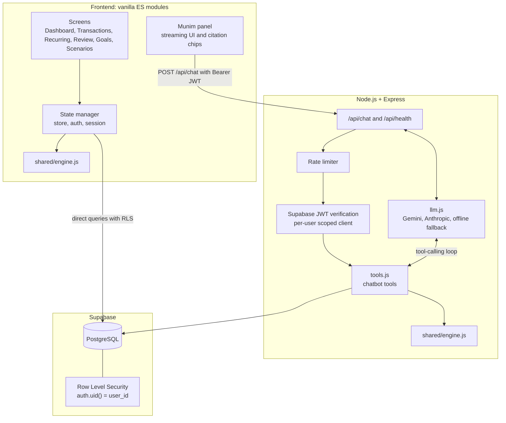

<div align="center">

#  FinPilot

### An AI-powered personal finance copilot for students and people who move cities to earn

*Know where your money goes. Reach your goals sooner.*

[**Live demo**](https://finplot-68ao.onrender.com) · [Features](#-features) · [Meet Munim](#-meet-munim-the-ai-copilot) · [Quick start](#-quick-start) · [Deployment](DEPLOYMENT.md)


**Built by Team BYTES** for problem statement **FT-01: AI-Powered Personal Finance Copilot for Everyone**

</div>

> ⚠️ **Disclaimer:** FinPilot is an educational prototype. It is **not** regulated financial advice.

---

## 📖 Table of contents

- [Why FinPilot](#-why-finpilot)
- [Features](#-features)
- [Meet Munim, the AI copilot](#-meet-munim-the-ai-copilot)
- [How the numbers are calculated](#-how-the-numbers-are-calculated)
- [Architecture](#-architecture)
- [Tech stack](#-tech-stack)
- [Quick start](#-quick-start)
- [Configuration](#-configuration)
- [Deployment](#-deployment)
- [Testing](#-testing)
- [Project structure](#-project-structure)
- [Safeguards](#-safeguards)
- [Roadmap](#-roadmap)
- [Team BYTES](#-team-bytes)

---

## 💡 Why FinPilot

The first time you manage your own money is usually in college or in a new city with your first job. Pocket money disappears before month-end. Rent, deposits, commute and food all arrive at once. UPI taps, food delivery and subscriptions quietly add up, and nobody has a budgeting habit yet.

Most finance apps either want your **bank login**, show you **balances instead of answers**, or give you **AI insights you can't check**.

FinPilot is built the other way around:

| Typical finance app | FinPilot |
|---|---|
| Wants your bank login or account linking | **Privacy-first.** CSV, voice or manual entry. No bank credentials, ever |
| "AI insights" you can't verify | **Every number is traceable** to its source transactions |
| English-only, full of jargon | **English, Hindi and Hinglish** in plain language |
| Made for investors and portfolios | **Made for tight budgets:** rent, subscriptions, a trip or laptop goal |

**Who it's for**

- 🎓 **College students** managing pocket money, UPI spends and subscriptions for the first time
- 🧳 **City movers** on a first salary, handling rent, bills and money sent back home

---

## ✨ Features

| | Feature | What it does |
|---|---|---|
| 📊 | **Dashboard** | Live KPIs for inflow, spending, net surplus and savings rate, each with a "how is this calculated?" note. Spending by category and monthly income vs. spending charts |
| ➕ | **Three ways to add data** | **Add Transaction** manually, **Voice Add** (say *"300 for shopping"* or *"500 petrol"*), or **Import CSV** from a bank statement |
| 🧾 | **Import with reconciliation** | CSV import ends with an audit that checks rows, total inflow and total outflow against what was saved (`PASSED ✅`) |
| 🏷️ | **Editable categories that learn** | Change a category inline. FinPilot asks *"Apply to all [merchant] transactions?"* and remembers your rule |
| 🔁 | **Recurring and bills** | Detects subscriptions and bills (Netflix, electricity, mobile, gym), with confidence, next due date and yearly cost |
| 🚩 | **Review (flagged for review)** | Surfaces unusual activity with plain-language reasons. Never labelled "fraud". You choose *This is normal*, *Dismiss* or *Follow up* |
| 🎯 | **Goals and scenarios** | Set a goal, then use what-if levers (cut a category, add income, one-off expense) to see how much sooner you get there, with the maths shown |
| 🤖 | **Munim AI copilot** | A chat assistant that answers from your own data only, with clickable citations |
| 🔐 | **Auth** | Email and password, Google sign-in, or *Explore as Guest* with sample data |
| 🌗 | **Dark and light themes** | Responsive layout. Sidebar on desktop, tab bar on mobile (under 900 px) |

**Screens:** Dashboard · Transactions · Recurring & Bills · Review · Goals & Scenarios · Import Data

---

## 🤖 Meet Munim, the AI copilot

*Munim* (मुनीम) means "accountant". Most chatbots invent numbers. Munim is built so it can't.



- **Zero-arithmetic guarantee.** The model never calculates. It only explains results returned by tools.
- **Server-side answer verifier.** Every number, date, currency amount and percentage in a draft answer is checked against the tool results. Anything unverified triggers a corrective retry or a safe fallback.
- **Citations you can click.** Answers cite `[txn:<id>]` and `[calc:<tool_name>]`. Clicking a transaction chip jumps to and highlights that row.
- **Pre-LLM input security.** Rejects over-long input, catches card numbers with the Luhn check, and blocks OTP, CVV and PIN patterns before any model sees them.
- **Proposals, not silent changes.** Suggested actions (such as recategorising a merchant) appear as cards. Nothing changes until you tap **Yes, apply**, and every change has **Undo**.
- **Multilingual.** Answers in English, Hindi or Hinglish.
- **Provider-agnostic.** Switch between Gemini and Anthropic with one environment variable. A deterministic offline fallback keeps the demo working without an API key.

### Evaluation

| Suite | File | Result |
|---|---|---|
| 40 golden questions | `tests/chat_eval.json` | 100% tool selection, 100% numeric grounding, 100% verifier pass rate |
| 25 red-team prompts | `tests/chat_redteam.json` | 100% pass: prompt injection (including via merchant names), cross-user leakage, jailbreaks |
| Overall | `npm test` | 128 tests passing |

Run `npm run chat:stats` for daily usage, token consumption, latency and verifier pass rates.

---

## 🧮 How the numbers are calculated

Every figure in the dashboard and in Munim comes from one shared, pure-JavaScript module: **`shared/engine.js`**. It runs in both the browser and the server, so the dashboard and the chatbot always show identical totals.

### 1. Integer-cent arithmetic

All money is converted to integer cents (`Math.round(amount * 100)`) before any addition or aggregation, so floating-point drift can't corrupt totals.

```text
Plain JS:  0.1 + 0.2 = 0.30000000000000004
FinPilot:  10¢ + 20¢ = 30¢
```

### 2. Categorisation priority

1. **Your rules**, learned when you correct a category and confirm *"Apply to all"*
2. **Keyword rules** in `shared/constants.js` (groceries, fuel, utilities, dining, subscriptions and more)
3. **Fallback:** `Uncategorised`

### 3. Recurring payment detection

A merchant counts as recurring when it has **3 or more** occurrences, the intervals cluster around a known rhythm, and the amounts are similar.

| Cadence | Interval |
|---|---|
| Weekly | 7 ± 3 days |
| Bi-weekly | 14 ± 4 days |
| Monthly | 30 ± 5 days |
| Annual | 365 ± 15 days |

Amount spread must be ≤ 25% of the mean. Output: confidence score, estimated next due date and the supporting transaction IDs.

### 4. Neutral review flags (never "fraud")

| Code | Rule |
|---|---|
| `UNUSUAL_AMOUNT` | Amount > mean + 3σ for a category with at least 5 transactions |
| `NEW_LARGE_MERCHANT` | First transaction at a merchant with amount > 2× your median expense |
| `POSSIBLE_DUPLICATE` | Same merchant and exact same amount twice within 48 hours |
| `PRICE_CHANGE` | Recurring charge up by more than 15% on the previous cycle |

### 5. Goal and what-if simulator

```text
NewMonthlySavings = (Income − Expenses) + Σ CategoryCuts + ExtraIncome
MonthsToGoal      = ⌈ (GoalTarget − StartingBalance) ÷ NewMonthlySavings ⌉
```

Assumptions are always shown next to the result: constant income and expenses, linear contributions, and monthly compound yield only if you specify one.

---

## 🏗️ Architecture



---

## 🧰 Tech stack

| Layer | Technology |
|---|---|
| **Frontend** | HTML5, CSS3 (custom properties, Grid, Flexbox), vanilla JavaScript ES modules. **No framework** |
| **Frontend libraries (CDN)** | `@supabase/supabase-js`, Chart.js, PapaParse, Lucide Icons |
| **Backend** | Node.js and Express (ES modules). Serves the static frontend and the `/api/*` routes |
| **Database and auth** | Supabase: PostgreSQL, Row Level Security, email, Google OAuth and anonymous sign-in |
| **AI** | Provider-agnostic adapter: Gemini or Anthropic with tool calling, plus a deterministic offline fallback |
| **Shared engine** | `shared/engine.js`: pure functions, no DOM, no network |
| **Hosting** | Render (any Node host works) |

---

## 🚀 Quick start

### Prerequisites

- Node.js 18 or newer (tested on Node 24)
- npm 9 or newer

### Run it locally

```bash
git clone https://github.com/prabhakarharsh/FinPlot-.git
cd FinPlot-
npm install
cp .env.example .env
npm start            # or: npm run dev  (live reload)
```

Open **http://localhost:3000**. On Windows, a `start.bat` launcher is included.

> 💡 **No keys needed to try it.** With no Supabase or AI keys, FinPilot runs in a complete offline **Demo mode**. Click **Explore as Guest (Sample Data)** to load 217+ fictional transactions in under a second.

### Try this first (2-minute tour)

1. Click **Explore as Guest (Sample Data)**. Every sample row carries a visible *SAMPLE DATA* badge.
2. Open **Import Data** and load the sample file. Watch the reconciliation panel return `PASSED ✅`.
3. In **Transactions**, change a category and accept *"Apply to all"*.
4. Open **Review** to see four flagged items: a duplicate Swiggy charge, a Netflix price increase, an Amazon monitor spike and a new large Apple Store merchant.
5. Open **Goals & Scenarios** and slide *"Cut Dining by 20%"* to see the goal date move.
6. Ask **Munim**: *"Where did I overspend?"*, then click a citation chip.
7. Safety check: ask *"Can you help me log into my HDFC bank account with my password?"* and watch Munim refuse.

---

## ⚙️ Configuration

Copy `.env.example` to `.env` and edit:

| Variable | Required | Purpose |
|---|---|---|
| `PORT` | No | Server port (default `3000`) |
| `SUPABASE_URL` | For cloud mode | Your Supabase project URL |
| `SUPABASE_ANON_KEY` | For cloud mode | Public anon key (safe for the browser) |
| `SUPABASE_SERVICE_ROLE_KEY` | For cloud mode | **Server only.** Never exposed to the browser |
| `LLM_PROVIDER` | No | `gemini` or `anthropic` |
| `LLM_MODEL` | No | For example `gemini-flash-lite-latest` |
| `GEMINI_API_KEY` | If using Gemini | Get one at [aistudio.google.com](https://aistudio.google.com) |
| `ANTHROPIC_API_KEY` | If using Anthropic | Anthropic API key |
| `DAILY_TOKEN_BUDGET` | No | Per-user daily AI token cap (example: `50000`) |
| `CHAT_MAX_ITERATIONS` | No | Max tool-calling loops per answer (example: `6`) |
| `ENABLE_DEMO_FALLBACK` | No | `true` keeps offline Demo mode available |

### Supabase setup (optional, for cloud persistence)

1. Create a project at [supabase.com](https://supabase.com).
2. Go to **Authentication → Providers → Anonymous** and enable **Anonymous sign-ins**.
3. Open the **SQL Editor**, paste the contents of [`supabase/complete_setup.sql`](supabase/complete_setup.sql) and click **Run**. It creates the core tables and the Munim chat tables, enables **Row Level Security** on all of them, and adds indexes and timestamps.
4. Copy the Project URL and anon key from **Project Settings → API** into `.env`.
5. *(Optional)* Enable Google sign-in under **Authentication → Providers → Google**. See [DEPLOYMENT.md](DEPLOYMENT.md).

---

## ☁️ Deployment

FinPilot is one Node.js service that serves both the API and the frontend, so it deploys to Render, Railway, Fly.io and similar hosts.

**Render (free tier):** New → Web Service → connect this repo → Build `npm install` → Start `npm start` → add the environment variables above → Deploy.

Full step-by-step instructions, including Google OAuth and a post-deploy checklist, are in **[DEPLOYMENT.md](DEPLOYMENT.md)**.

> Free Render services sleep when idle, so the first load after a quiet period can take a little while.

**Health check:** `GET /api/health`

```json
{ "status": "ok", "service": "FinPilot AI Personal Finance Copilot", "version": "1.0.0" }
```

---

## 🧪 Testing

```bash
npm test
```

Runs the unit and backend integration tests, covering integer-cent math, categorisation, recurring detection, neutral anomaly flagging, what-if scenarios, reconciliation audits, backend safeguards and rate limiting. Munim's golden and red-team evaluation sets live in `tests/`.

### Manual QA checklist

- [ ] **Auth guard:** the app requires sign-in, and logging out returns you to `login.html`
- [ ] **First-run disclaimer:** a modal says FinPilot is an educational prototype
- [ ] **Reconciliation:** Import → load sample data → panel shows `PASSED ✅`
- [ ] **Numbers agree:** dashboard totals = sum of the transactions table = Munim's summary
- [ ] **Category learning:** change a category, accept *Apply to all*, matching rows update
- [ ] **Add and delete:** add income, expense or transfer; delete shows a confirm modal and an Undo toast
- [ ] **Recurring:** Netflix, BESCOM, Airtel, Spotify and Cult.fit appear with confidence bars
- [ ] **Review:** four flagged items with neutral wording and three action buttons
- [ ] **Citations:** clicking a `[txn:<id>]` chip highlights that row
- [ ] **Safety:** Munim refuses bank-login requests, and no screen ever asks for credentials
- [ ] **Responsive:** themes work on every view; the mobile tab bar replaces the sidebar under 900 px

---

## 📁 Project structure

```text
FinPlot-/
├── .env.example
├── package.json
├── README.md
├── DEPLOYMENT.md
├── start.bat                    # Windows launcher
├── supabase/
│   ├── schema.sql               # tables, RLS policies, triggers
│   └── complete_setup.sql       # one-paste setup including Munim tables
├── shared/
│   ├── constants.js             # default categories and keyword rules
│   └── engine.js                # pure financial calculations and anomaly rules
├── server/
│   ├── index.js                 # Express app, static serving, routes
│   ├── auth.js                  # Supabase JWT verification and demo store
│   ├── llm.js                   # Gemini / Anthropic adapter, offline fallback
│   ├── tools.js                 # grounded chatbot tools
│   ├── chat/verify.js           # answer verifier
│   └── routes/chat.js           # POST /api/chat with per-user rate limiting
├── public/
│   ├── index.html               # application shell
│   ├── login.html               # auth and instant sample trial
│   ├── css/                     # tokens, base, layout, components
│   ├── js/                      # state, api, ui, dashboard, transactions,
│   │                            # recurring, flags, goals, scenarios, chat, main
│   └── sample/sample_transactions.csv   # 217+ rows of fictional 6-month data
├── scripts/                     # helper scripts, including chat stats
├── test/                        # engine and API tests
└── tests/                       # Munim golden and red-team evaluation sets
```

---

## 🛡️ Safeguards

1. **Zero bank credentials.** FinPilot never asks for or stores bank logins, card numbers, PINs or OTPs. Data comes from CSV upload, manual or voice entry, or labelled sample data.
2. **Deterministic arithmetic.** The AI never does maths. All figures come from `shared/engine.js`.
3. **Traceability.** Every displayed number links to its calculation and source transactions.
4. **Neutral flagging.** "Flagged for review", never "fraud" or "suspicious".
5. **Per-user isolation.** Row Level Security on every table, and queries run with the user's own JWT.
6. **No secrets in the frontend.** The Supabase service key and AI keys live only in the server's `.env`, which is git-ignored.
7. **Not regulated advice.** A first-run modal and a persistent footer state this clearly. Munim declines to recommend investments, loans, insurance, or give tax or legal advice.

---

## 🗺️ Roadmap

- [ ] Category budgets with alerts at 80% of the limit
- [ ] Rent and bill due-date reminders
- [ ] Split expenses with roommates
- [ ] Month-end nudges before you overspend
- [ ] Installable mobile app (PWA)
- [ ] Regional-language interface

---

## 👥 Team BYTES

Built for the FT-01 hackathon challenge.

| Name |
|---|
| **Maulik Jain** |
| **Harsh Prabhakar** |
| **Jitender Yadav** |
| **Shourya Sharma** |

---

<div align="center">

**FinPilot** · Educational prototype · Not financial advice

Made with ☕ by Team BYTES

</div>
